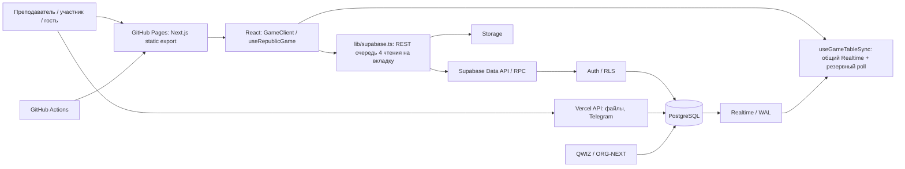
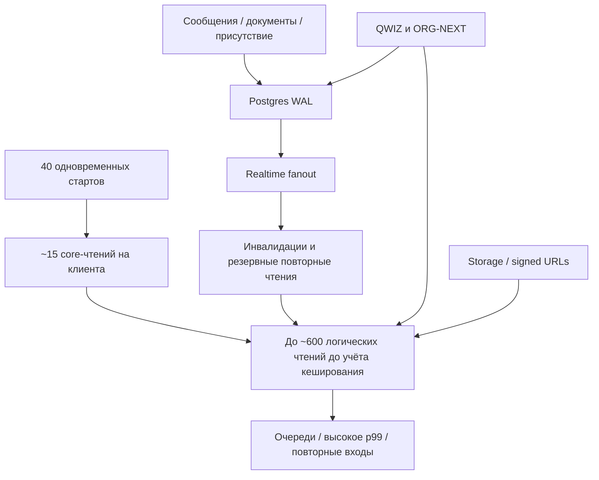

# ГОС.ID — архитектура и нагрузка (29.10.2026)

Проверенный HEAD: `c1c998afd91511a494fb4406ab26ad097fbe5860`; база Supabase `bderfrcfuhnutuoyudje`. Данные из GitHub main, pg_stat_statements, pg_stat_activity, pg_stat_user_tables, Supabase Edge Logs (24 ч) и Advisors. **Этот аудит не является завершённым нагрузочным тестом 40–100 реальных пользователей.**

## Архитектура

Существующая полная система: 245 таблиц public, 281 политика RLS, 571 public RPC/функция, 38 Realtime-таблиц; дерево текущего GitHub: 2327 элементов, 2268 файлов и 453 миграции. Совместное использование базы другими играми увеличивает суммарную нагрузку.

**Путь входа:** Supabase Auth → ensure_my_game_access → get_my_game_identity → loadCoreSections (игра, персональное членство, общий roster, метрики, события, чаты, этапы, партии, голосования, документы, оценки, кризисы, профили и интро) → Realtime → рабочие модули.

**ВАЖНО:** персональная проверка членства не должна подменяться общим roster: PR #461 закрыт после регрессионного теста; серверные проверки ролей и RLS остаются обязательными.

## Измеренные узкие места

Edge Logs за последние 24 ч на момент аудита, время response.origin_time в мс:

| Endpoint | Запросов | p95 | p99 | 5xx |
|---|---:|---:|---:|---:|
| game_office_assignments | 1254 | 3440 | 20542 | 0 |
| event_assignments | 1146 | 2404 | 22477 | 0 |
| event_collaboration_invites | 1154 | 1911 | 19224 | 0 |
| party_documents | 673 | 4050 | 20979 | 1 |
| game_parties | 964 | 2406 | 15398 | 1 |
| game_profiles | 1160 | 1828 | 13252 | 0 |
| rpc/get_section_updates | 653 | 3580 | 17766 | 2 |
| rpc/record_my_game_presence | 960 | 3729 | 21991 | 5 |
| game_members | 1680 | 863 | 4326 | 0 |
| rpc/qwiz_party_projection (другая игра) | 3552 | 1158 | 4120 | 9 |

Одномоментный снимок: **33 из 60 соединений, 2 active, 0 Lock waits**. Из него нельзя вывести причину сбоев при 15 одновременных участниках. `pg_stat_statements`: 1 152 791 вызов WAL decoder (накопительно), 28 072 Storage object lookups, ~16 570 вызовов get_section_updates — эти счётчики **не** ограничены указанными 24 ч. Индексы нельзя массово добавлять только по seq_scan на маленьких таблицах.

## Причинный граф рисков

Число «600» — теоретический объём запросов входа 40×15, а не наблюдаемое количество в production. В `lib/supabase.ts` уже есть очередь 4 чтения на вкладку, 48 ожидающих, задержка 12 с и breakers HTTP 402/429/503. В `useRepublicGame.ts` уже есть scoped-кеш на 10 минут для партий/отображения назначений; `useGameTableSync.ts` использует один общий Realtime-канал; `get_section_updates` уже оптимизирован PR #462. **Не повторять эти изменения.**

## План минимальных исправлений

| Приоритет | Изменение | Защита от регрессии |
|---|---|---|
| P0 | Профилировать Auth, core hydration и рост очереди при 40 отдельных JWT | Личные роли/RLS не объединять в общий cache |
| P0 | Сократить `EventWorkspace`: только нужные case ID, узкие SELECT, lazy subqueries | Проверять события по должностям и разрешениям |
| P0 | Уменьшить избыточные UPSERT присутствия, проверить 5xx и WAL fanout | Два окна, offline/online, read receipts |
| P0 | Сохранить RPC-атомарность голосования, проверить 100 конкурирующих дублей | Ноль повторных начислений / голосов |
| P1 | Для `party_documents` и `formal_documents` вынести тело в on-demand read, пагинация | Права/версии/подписи документов |
| P1 | Узко анализировать Storage signed URL и повторную генерацию | Изоляция доступа, снижение egress |
| P1 | Измерить hit-rate 10-минутных кешей партий и назначений | Изменения ролей на сервере мгновенно авторитетны |
| P2 | Отложить/пакетировать фоновые задачи и Telegram от пика | Нет пропавших задач, контроль дубликатов |
| P2 | Только адресно индексировать подтверждённые тяжёлые JOIN | EXPLAIN и измерения до/после |
| P2 | Сократить JS initial bundle и проверить мобильный UX | Никакого изменения утверждённой айдентики |

## Проверка для закрытия задачи

В **disposable локальной Supabase**, с защитой от production:
1. 40 отдельных авторизованных клиентов, массовый старт и 20+ минут;
2. 100 клиентов, Realtime, документы, чат, изменение этапов;
3. Конкурентные голоса, повторная отправка, нет пропавших действий;
4. Имитация отключения сети / JWT refresh / невидимой вкладки;
5. Отдельно измерить влияние QWIZ/ORG-NEXT;
6. Зафиксировать p50/p95/p99, 4xx/5xx, 402, запросов/мин, egress, WAL events/second и CPU/IO;
7. Регрессия student/teacher/guest и desktop/tablet/phone.

Целевые, **ещё не достигнутые** SLO: >=99,9% подтверждённых действий без потерь; ноль двойных голосов и утечек; p95 ключевого игрового чтения <1 с и p99 <3 с на контролируемой среде; ноль HTTP 402. Внешние ограничения могут требовать коррекции SLO.

## Ограничения

Не проведён полный сквозной функциональный аудит всех 16 этапов, 571 функции и 281 RLS-политики. Не подключён Datadog RUM (на момент запроса он был отключён). Не запускался production stress test и не выполнялось перераспределение данных на Redis/Neon. Браузерный клиент PostgREST **не** переводить на PostgreSQL-порт 6543. Изменения серверных прав — только отдельными проверяемыми миграциями.
